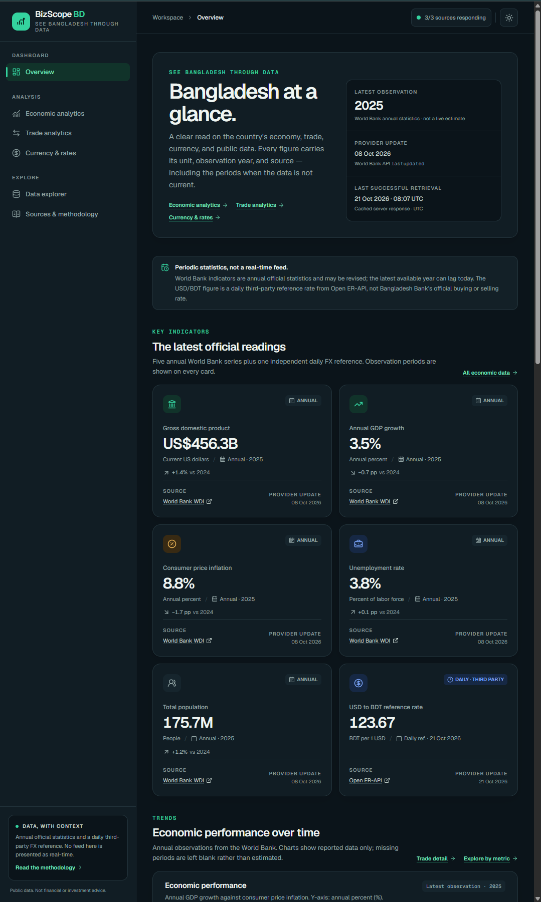

# BizScope BD

**See Bangladesh Through Data.** A production-minded business intelligence dashboard for Bangladesh's economy, trade, currency reference rates, public datasets, and browser-based economics and statistics calculators.

BizScope BD is built around a simple rule: **every number must carry its source, unit, observation period, and honest freshness.** Annual statistics are never relabelled as current, and a daily third-party currency reference is never presented as an official Bangladesh Bank rate or a live market quote.



*Overview dashboard — annual World Bank readings, with GDP and trade shown in BDT equivalents, plus the daily ExchangeRate-API dollar–taka reference rate. Each value keeps its observation period and source update time.*

---

## What is included

- **Overview** (`/`) — key economic readings, a trade snapshot in BDT, trend charts, latest observations, source freshness, and source status.
- **Economic analytics** (`/economy`) — seven World Bank series with a metric selector, year-range filters, line/bar views, definitions, gap reporting, and an annual data table. GDP is shown in BDT using the current reference rate.
- **Trade analytics** (`/trade`) — exports and imports of goods and services in BDT, a derived trade balance, export coverage, comparison charts, and methodology panels.
- **Currency & rates** (`/currency`) — dollar–taka reference rate, a currency converter, a searchable taka-per-unit rate table, timestamps, attribution, and separate official Bangladesh Bank links.
- **Econ Math** (`/math`) — 41 bilingual economics and statistics calculators with editable tables, Excel/Google Sheets paste, formulas, substituted values, step-by-step solutions, and plain-language interpretations. All calculations run in the browser.
- **Data explorer** (`/data`) — live OpenDataBD catalog with stats, debounced search, category filtering, pagination, dataset metadata, and source links. Dataset files are not proxied.
- **Sources & methodology** (`/sources`) — plain-language source register, live checks, the seven indicators, update frequency, licensing, and limitations.

The interface includes a responsive sidebar/mobile navigation drawer with focus management, light and dark themes (system preference on first visit), loading skeletons, empty and error states, retry actions, accessible charts with companion tables, and no horizontal page overflow on small screens.

Every page, chart label, table, notice, empty/error state, metadata title, and methodology section is available in **English and Bangla**. The header language toggle stores the choice in the `bizscope-language` cookie and refreshes the server-rendered page, so navigation, metadata, and client components stay in sync. Bengali pages use `lang="bn"`, the Noto Sans Bengali font, and extra heading line-height for correct glyph rendering. Numeric values, observation years, and source timestamps keep their original data formatting.

---

## Stack

| Layer | Choice |
| --- | --- |
| Framework | Next.js 16.4.2 (App Router, Turbopack) |
| UI | React 19.3, TypeScript 5 (strict), Tailwind CSS v4 |
| Charts | Recharts 3.10 |
| Math engine | Custom TypeScript for distributions, hypothesis tests, economics, and finance; browser-only, with no external math package |
| Icons | Lucide React |
| Data access | Native `fetch` in server components and Route Handlers |
| Storage | None required; no database, no API keys. Econ Math inputs stay in browser memory only. |
| Languages | English and Bangla, cookie-backed server rendering |
| Lint | ESLint 9 with `eslint-config-next` |

No environment variables are required.

---

## Getting started

Requirements: **Node.js 20.9+** and npm.

```bash
npm install
npm run dev
```

Open [http://localhost:3000](http://localhost:3000).

Production build:

```bash
npm run build
npm start
```

Quality checks:

```bash
npm run lint
npx tsc --noEmit
npm run build
```

---

## Econ Math

`/math` is a bilingual economics and statistics workbench with **41 calculators** in seven categories:

| Category | Covered methods |
| --- | --- |
| Descriptive statistics | Summary statistics, grouped frequency tables |
| Hypothesis testing | One-sample Z and t tests, two-sample t test (Welch or pooled), paired t test, two-proportion Z test, variance F test, χ² goodness-of-fit and independence tests, one-way ANOVA |
| Regression & correlation | Pearson correlation, Spearman rank correlation, simple OLS |
| Microeconomics | Market equilibrium, price/income/cross elasticity, cost analysis, monopoly profit, consumer and producer surplus |
| Macroeconomics | GDP expenditure approach, GDP deflator, CPI inflation, CAGR, GDP per capita, unemployment, money and expenditure multipliers, Fisher equation |
| Finance | Compound interest, effective annual rate, present/future value, annuities, NPV, IRR, payback, break-even, loan EMI, depreciation |
| Index numbers | Simple and weighted price index |

Calculators use editable parameter fields and data tables:

- Add or remove rows; ANOVA and contingency tables support dynamic numeric columns.
- Paste a block from Excel or Google Sheets (tab- or comma-separated) into any cell.
- Load bilingual example data, clear the current draft, or type values directly.
- Validate values inline instead of failing silently.

Each result shows the formula, substituted values, numbered working, a plain-language decision or interpretation, warnings, and the assumptions behind the method. The **Formula guide** tab collects every formula, symbol, use case, and assumption. All calculator labels, help text, examples, and interpretations are available in English and Bangla.

**Statistical conventions:** α defaults to 0.05; the two-sample t test defaults to Welch's approximation with a pooled-variance toggle; p-values below 0.0001 display as `p < 0.0001`; rates are entered as decimals (8% = 0.08).

**Privacy and limits:** calculations run entirely in your browser from the values you enter. Nothing is uploaded, stored, logged, or sent to an API, and reloading the page discards the work. Econ Math is an educational aid, not financial advice or a replacement for R, Stata, SPSS, or a reviewed statistical workflow.

---

## Web analytics

Page-view measurement uses Cloudflare Web Analytics. The beacon is loaded once from `app/layout.tsx`, after the app shell and before the closing `</body>` tag. Cloudflare records traffic only for the hostname configured in its dashboard; requests from `localhost` are rejected by Cloudflare's CORS policy and do not affect the dashboard.

## Data sources

### Integrated automatically

| Source | Data used | Update cadence | Integration |
| --- | --- | --- | --- |
| [World Bank — World Development Indicators](https://data.worldbank.org/country/bangladesh) | Seven annual BGD indicators via the public Indicators API (`format=json&mrnev=10`) | Annual, periodically revised | JSON REST, no key |
| [ExchangeRate-API](https://www.exchangerate-api.com/docs/free) | Daily reference rates, including BDT | Daily reference update | JSON REST, no key for the open feed |
| [OpenDataBD](https://opendatabd.com/) | Public dataset catalog and platform statistics | On demand; catalog changes over time | Public JSON endpoints, metadata only |

**World Bank indicator codes**

| Key | Code | Published unit | Shown in the dashboard |
| --- | --- | --- | --- |
| GDP | `NY.GDP.MKTP.CD` | Current US$ | BDT equivalent |
| GDP growth | `NY.GDP.MKTP.KD.ZG` | Annual % | Annual % |
| Inflation | `FP.CPI.TOTL.ZG` | Annual % | Annual % |
| Unemployment | `SL.UEM.TOTL.ZS` | % of labor force | % of labor force |
| Population | `SP.POP.TOTL` | People | People |
| Exports | `NE.EXP.GNFS.CD` | Current US$ | BDT equivalent |
| Imports | `NE.IMP.GNFS.CD` | Current US$ | BDT equivalent |

The World Bank publishes GDP, exports, and imports in current US dollars. BizScope BD converts those three series to BDT at the current daily reference rate and labels them as BDT equivalents. The observation year remains the World Bank's year; the conversion rate is not the historical exchange rate for that year.

### Linked, not automated

| Source | Status | Why |
| --- | --- | --- |
| [Bangladesh Bank](https://www.bb.org.bd/) | Official manual link | No documented public JSON endpoint was verified for the exchange-rate pages. During implementation those pages returned an interactive browser-verification screen, so the app does not scrape them. |
| [Bangladesh Bureau of Statistics](https://bbs.gov.bd/) | Official manual link | BBS publishes HTML, PDF, and spreadsheet publications. No verified public JSON API is used for the indicators shown here. |
| [data.gov.bd](https://data.gov.bd/) | Directory | Used as a discovery directory. No machine-readable catalog endpoint was verified for this release. |

The Sources page distinguishes these integrations clearly. Official sources are never merged into World Bank-derived charts.

---

## Data integrity decisions

- **Shape validation:** every upstream response is checked before use. Invalid currencies, missing BDT, malformed World Bank rows, and unexpected catalog records are rejected rather than guessed.
- **No invented values:** missing annual observations stay missing. Charts do not interpolate, extrapolate, or backfill values.
- **No fake history for FX:** ExchangeRate-API supplies a current daily snapshot. The currency page does not manufacture a time series from that single snapshot.
- **BDT conversion:** GDP, exports, and imports are converted from the World Bank's US-dollar series using the current daily dollar–taka reference rate. The same rate is applied to every year, so these are present-day BDT equivalents, not historical exchange-rate conversions. The rate and its update date are shown next to the money values. If the rate is unavailable, the app labels the source values in US dollars instead of inventing a conversion.
- **Derived trade figures:** trade balance and export coverage are calculated only where exports and imports exist for the same year and share the World Bank goods-and-services definition. They are labelled as derived.
- **Comparison safety:** percentage-point changes are used for percent series, percent changes for levels, and deltas are withheld when the two latest observations are not consecutive years.
- **Partial failure handling:** the seven World Bank indicators are fetched with `Promise.allSettled`. One failed series does not remove the others; failures are sanitised and surfaced without upstream bodies.
- **Provider timeouts:** upstream requests use `AbortSignal.timeout`, with a 12-second default (10 seconds for the currency feed).
- **Sanitised errors:** upstream error bodies and headers are never forwarded to the browser.
- **Observation periods:** every KPI, chart, and table states the observation year or period. A source's "last updated" date is shown separately from the observation year.
- **No real-time claims:** the dashboard describes annual statistics and a daily third-party reference accurately. Nothing is presented as a live ticker.
- **Client-side math:** Econ Math computes from user-entered values in the browser. Input tables, drafts, and results are never posted to a Route Handler or third-party service.
- **Statistical transparency:** hypothesis tests require an explicit α and alternative-hypothesis choice, and report the test statistic, degrees of freedom, p-value, decision, assumptions, and warnings. A calculator result is not presented as a substitute for reviewed statistical software.

---

## Caching and freshness

Server-side caching is intentionally aligned with provider cadence.

| Data | Application cache | Page revalidation | API response cache |
| --- | --- | --- | --- |
| World Bank indicator | 6 hours per indicator | 30 minutes | `s-maxage=21600` when complete |
| ExchangeRate-API rates | 1 hour | 30 minutes | `s-maxage=3600` |
| OpenDataBD catalog | 10 minutes | Client fetch on demand | `s-maxage=600` |
| OpenDataBD stats | 1 hour | — | Included with catalog responses |
| Provider health | Live data functions | Client fetch | `s-maxage=300` |

`unstable_cache` is used at the data-function layer. Upstream calls use `cache: "no-store"` inside those cached functions. Failed responses are returned as explicit error states and are not presented as fresh observations.

---

## Internal API

All endpoints are public GET routes on the same deployment.

| Endpoint | Purpose | Notable parameters / status |
| --- | --- | --- |
| `/api/analytics` | Normalised World Bank indicators and summary | `200` for complete/partial, `503` if every indicator fails |
| `/api/currency` | Validated USD reference rates and BDT rate | `200` for a valid feed, `502` on provider failure |
| `/api/datasets` | OpenDataBD catalog proxy | `q` (≤80 chars), `category`, `page` (1–1000), `limit` (1–24, default 12); `502` on provider failure |
| `/api/status` | Provider health snapshot | Always `200`, with per-provider states |

Responses include `X-Data-Status` and an `X-Data-Cadence` header where relevant. The in-app Sources page uses plain-language explanations; implementation details for the Route Handlers live in `app/api/`. There is no Econ Math API endpoint: all calculations happen in the client bundle.

---

## Project structure

```text
app/
  page.tsx                 Overview dashboard
  economy/page.tsx         Economic analytics
  trade/page.tsx           Trade analytics
  currency/page.tsx        Currency & rates
  math/page.tsx            Econ Math calculators and formula guide
  data/page.tsx            OpenDataBD explorer
  sources/page.tsx         Sources, health, methodology
  api/                     Analytics, currency, datasets, status handlers
  layout.tsx               Metadata, fonts, theme bootstrap, shell
  globals.css              Design tokens and Tailwind v4 theme
components/
  app-shell.tsx            Responsive navigation shell and focus trap
  language-provider.tsx    Client language context and copy hooks
  language-toggle.tsx      Cookie-backed language switch in the header
  charts/                  Recharts wrappers, tooltip, legend, empty state
  ui/                      Panels, badges, KPIs, notices, states, skeletons
  economy/ trade/ currency/ data/ overview/ sources/
  math/                    Calculator picker, input tables, results, formula guide
lib/
  api/                     Typed provider clients, validation, cache, status
  i18n.ts                  Shared UI copy and language types
  i18n-server.ts           Server cookie reader for layouts and pages
  indicator-catalog.ts     Bilingual indicator definitions and codes
  sources.ts               Bilingual source registry and integration status
  econ-math/               Client-side statistics, economics, finance, and index engine
  utils/                   Formatting, metrics, BDT conversion, trade derivations
```

---

## Accessibility and UX notes

- Semantic headings, landmarks, table captions, and scope attributes.
- Charts have accessible group labels and visible companion tables (economy and trade).
- Mobile drawer closes on navigation, supports Escape, traps focus, restores focus, and locks body scroll.
- Visible focus rings, reduced-motion support, and `aria-live` regions for async updates.
- Econ Math supports spreadsheet-style block paste, add/remove rows and columns, keyboard data entry, inline validation, horizontally scrollable input and result tables, and `aria-live` result updates.
- Light/dark themes with system preference on first visit and a persisted manual choice.
- English/Bangla toggle with a persisted cookie, correct `<html lang>`, localized page titles, and a font stack that covers Bengali glyphs.
- No horizontal page scrolling at tested widths (360, 390, 414, 768, 1440 px) in either language; wide tables scroll within keyboard-focusable panels.
- Empty, error, partial, and loading states are implemented rather than leaving blank panels.

---

## Known limitations

- Upstream availability is not guaranteed. The app reports failures honestly rather than substituting numbers.
- World Bank observations are annual, may be revised, and can lag the current calendar year. Historical revision tracking is out of scope.
- Unemployment is an ILO modelled estimate.
- Trade values are nominal and cover goods and services, not merchandise-only customs data. They are converted to BDT at the current reference rate, not the exchange rate from each historical year.
- The OpenDataBD catalog is broad; dataset subjects, formats, licences, and access conditions vary. Files may require authentication and are never proxied by BizScope BD.
- Econ Math is an educational calculator. Results depend on the entered data and the selected method's assumptions; critical results should be verified independently. Drafts and results are not saved, and reloading the page clears them.
- ExchangeRate-API rates are third-party references, not Bangladesh Bank buying/selling rates and not transaction quotes.
- The app intentionally has no database. Server data is fetched and cached for each release; Econ Math inputs remain in browser memory only.

---

## Verification

Run against the live providers on **21 October 2026**, with Econ Math checks on **22 October 2026**:

- `npm run lint` — passed with no errors or warnings.
- `npx tsc --noEmit` — passed.
- `npm run build` — passed (Next.js production build, all routes compiled; content routes are dynamic because the root layout reads the language cookie).
- Live endpoint checks — `/api/analytics` returned all 7 indicators, `/api/currency` returned a valid dollar–taka reference feed, `/api/datasets` returned catalog pages plus validated search/filter/pagination, and `/api/status` reported all three providers operational.
- Page checks — `/`, `/economy`, `/trade`, `/currency`, `/data`, and `/sources` all returned `200`; an unknown route correctly returned `404`.
- Econ Math checks (22 October 2026) — `npm run lint`, `npx tsc --noEmit`, and `npm run build` passed with all 41 calculators registered. `/math` returned `200` for the default view and for `?calc=z-test-mean&tab=formulas`, with the calculator count, formula guide, and privacy notice present in the server-rendered HTML. The browser/axe pass below covers the six data pages and predates Econ Math; a dedicated `/math` browser pass is still pending.
- Browser checks - Playwright on the production build: no application console or page errors (the Cloudflare beacon's localhost CORS rejection is external and expected), axe reported zero WCAG A/AA violations on all six pages in English and Bangla, theme persistence and system-dark preference worked, the mobile drawer trapped focus and restored it on Escape, and the converter, economy filters, and dataset search all worked. A standard 390 px context reported a 390 px layout and document width; all six routes stayed at the viewport width with no horizontal panning at 360, 390, 414, and 768 px in both languages.
- Bilingual checks - the header toggle changed server-rendered content, page title, and `<html lang>`; the cookie survived reloads and new tabs; English and Bangla copy objects had matching keys and array lengths; no English dashboard UI phrases appeared in Bangla mode; and every route was checked for localized headings, titles, empty/error copy, and accessible names.
- BDT display checks — overview, economy, and trade showed taka values with the conversion rate and update date; the currency rate table showed taka per unit; the Sources page contained no internal endpoint or cache table.
- One benign `net::ERR_ABORTED` appears for `/api/status` when a navigation cancels the previous page's in-flight health request; it is not a data or rendering failure.

An out-of-range catalog page (`page=999`) returns a sanitised `502` because the upstream catalog API rejects it; the UI only offers pages within the reported page count.

Provider values change over time. Treat the observation year, provider timestamps, and source links shown in the running app as authoritative.

---

Public data, clearly sourced. Not financial or investment advice.
